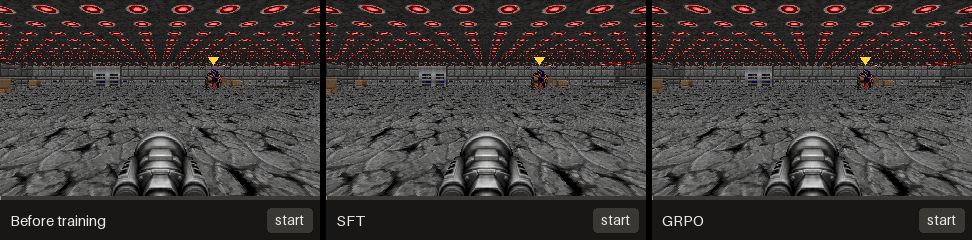
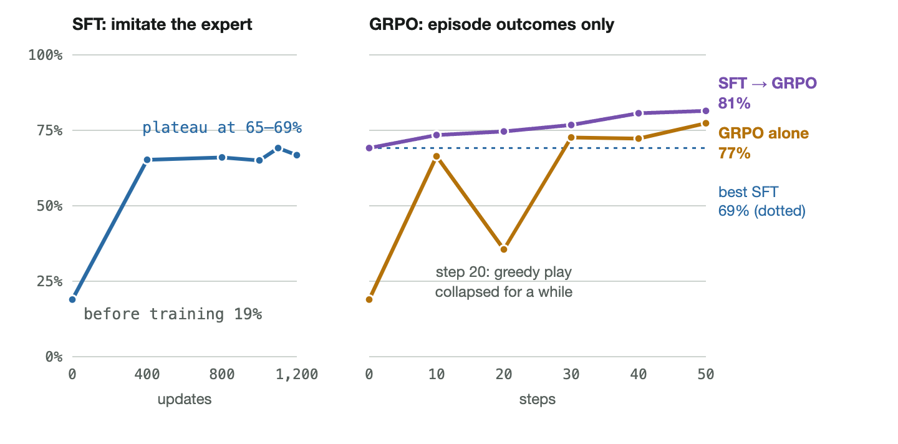
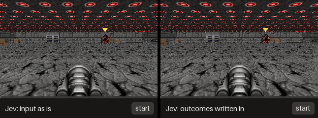
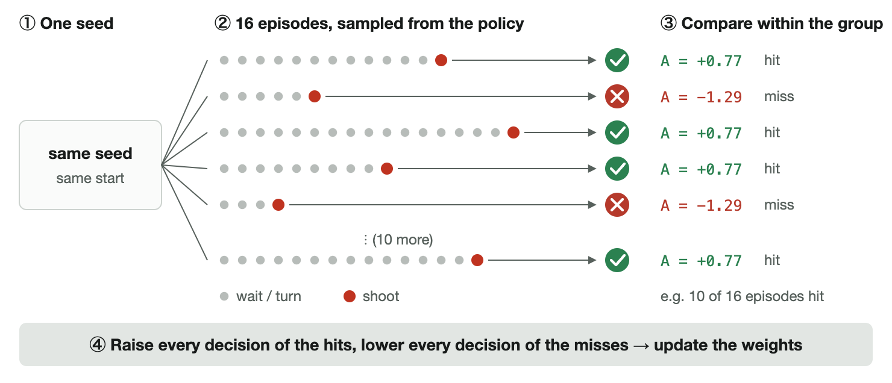

# NanoJev-GRPO — GRPO post-training for NanoJev decision models

**English** | [简体中文](README.zh-CN.md) | [日本語](README.ja.md)

> **This is an unofficial extension of [NanoJev](https://github.com/TianyuCodings/NanoJev) by [TianyuCodings](https://github.com/TianyuCodings).**
> The decision model, the released checkpoint and dataset, and the game environments are NanoJev's work. This repository starts from NanoJev commit [`76fdfc9`](https://github.com/TianyuCodings/NanoJev/tree/76fdfc9) with its history kept, and adds reinforcement learning from episode outcomes (GRPO) on top of it. Many thanks to the original author. Any mistakes in the additions are mine.



*One seed, three checkpoints, replayed from recorded actions. The released NanoJev weights and their SFT continuation fire at once and miss; the GRPO checkpoint waits and hits. On the 128 test episodes SFT misses and GRPO hits in 36, and the reverse happens in 11; this clip is one of the 36. The yellow marker is drawn by the replay tool.*

## What this repository shows

A decision model returns a probability for each candidate in one forward pass and generates no text. That makes it fast, and it also means it has nowhere to think about what a choice will lead to. Public game demos get around this by letting code simulate every option and write the outcome into the input.

This repository tests the other route: put the look-ahead into the weights. It trains NanoJev (Qwen3-0.6B with decision heads) on ViZDoom Predict Position with **GRPO over whole episodes**: no expert labels, no simulated outcomes in the input, only whether the episode ended in a kill.

| Checkpoint | Expert labels | Success on 640 episodes, greedy / sampled | 8 ticks per decision (128) | ViZDoom Basic (128) |
|---|---|---:|---:|---:|
| Released NanoJev weights | — | 19.4% / 18.0% | 14 | 128 |
| SFT on the expert's actions | yes | 68.6% / 66.1% | 57 | 128 |
| **GRPO from the released weights** | **no** | **79.1% / 77.2%** | 34 | 107 |
| GRPO continued from the SFT plateau | SFT part only | 81.4% / 80.8% | 69 | 128 |

- The 640 episodes are the released test split (128) plus 512 held-out seeds; none are used in training.
- SFT and GRPO start from the same weights and use the same 512 training seeds. On the 640 episodes SFT alone succeeds in 72, GRPO alone in 139 (exact sign test, p < 0.00001).
- SFT plateaus after about 400 updates; 800 more do not help. GRPO passes that level without labels, and GRPO started from the SFT plateau climbs further.



### Known weaknesses

- **It learns a way of playing that fits the training condition.** The GRPO policy waits and then shoots. With 8 ticks per decision instead of 4 it never fires in 75 of 128 episodes (when it does fire it hits 64% of the time, against 45% for SFT), and on ViZDoom Basic all 21 failures are timeouts.
- **Success went up; the look-ahead itself is not shown to be better than SFT's.** How well p(shoot) separates states where a shot hits from states where it misses (AUC, monster visible and time left): 0.64 before training, 0.80 after SFT, 0.76 after GRPO.
- **Greedy play collapsed for a while** around step 20 of the GRPO run; sampled play did not.
- **The last row is not a controlled comparison with the GRPO row.** It uses 1,600 fresh seeds, 32 seeds per step, 2 updates per step and a third of the learning rate.
- **Small scale:** one training run per row, one game, a 0.6B model.

## Why: the model reads, it does not look ahead

The same repository measures the hosted Jev model (`typesafe/jev-1.13`) on the same task.



| Who chooses | What the candidates say | Success (128 test episodes) |
|---|---|---:|
| Uniform random | — | 12 |
| Jev | Original text, e.g. `Hold attack for 4 Doom ticks.` | 0 |
| Jev | Original text + the outcome simulated by code | 112 |
| Jev | Same, plus an instruction that explains the annotation | 126 |
| Code only: pick the option whose text says it kills | — | 126 |

- The 126 episodes Jev wins with annotations are exactly the 126 that the code-only rule wins.
- Jev answers explicit questions about the state (is the monster right of the screen centre?) 97.7% of the time. Its p(shoot) does not separate hits from misses (AUC 0.49).
- On Snake, where every rule is known, Jev is 100% on a lookup question, 63.5% on applying the rule one move ahead and 70.0% five moves ahead. Chat LLMs that reason before answering reach 98–100% and 72–99%; the same LLMs answering in one word drop to 39.5–50.5% on the five-move question. The gap comes from being able to think before answering.

## How GRPO is applied to a decision model



It is the GRPO used for LLMs with two substitutions: one action is a choice among the candidates instead of a token, and one trajectory is an episode (20 to 30 decisions) instead of one answer.

```text
A_i     = (r_i - mean(r)) / std(r)                      r_i in {0, 1}, over the 16 episodes of one seed
rho_i,t = pi_theta(a_i,t | s_i,t) / pi_old(a_i,t | s_i,t)
L       = - mean over decisions of  min(rho_i,t * A_i, clip(rho_i,t, 1 - eps, 1 + eps) * A_i),   eps = 0.2
```

Groups whose 16 outcomes are all equal carry no signal and are dropped. There is no critic, no KL term and no reference model. The two functions are `group_advantages` and `clipped_loss` in [`scripts/pp_rl.py`](scripts/pp_rl.py); the full description is in [`docs/PP_RL.md`](docs/PP_RL.md).

`scripts/pp_tree.py` makes this affordable: the state and question are encoded once per decision and the candidates share that prefix, about 530 tokens per decision instead of about 1,950, with the same outputs (`pp_rl.py check-forward`).

## Quick start

One CUDA GPU is required (the runs above used one A100 40 GB) and CPU cores for the ViZDoom workers.

```bash
git clone https://github.com/Hajime-Y/nanojev-grpo && cd nanojev-grpo
bash scripts/pp_setup.sh        # .venv, pinned requirements, NanoJev checkpoint and dataset from Hugging Face
source .venv/bin/activate
```

Evaluate the released weights (expect 27/128):

```bash
python scripts/pp_rl.py eval --checkpoint checkpoints/NanoJev-unified \
  --cases configs/sonic_predict_supervision_v1_cases.jsonl --splits test --mode greedy \
  --workers 24 --output runs_pp/base_test_greedy.jsonl
```

GRPO from the released weights, and the SFT control:

```bash
scripts/pp_train.sh grpo_main grpo --steps 50 --tasks-per-step 16 --group-size 16 --minibatches 8 \
  --clip 0.2 --temperature 1.0 --backbone-lr 1e-5 --head-lr 1e-4 --eval-every 5 --save-every 10 --workers 24

scripts/pp_train.sh sft_main sft --updates 1200 --batch-questions 64 --backbone-lr 1e-5 --head-lr 1e-4 \
  --eval-every 100 --save-every 100 --workers 24
```

GRPO continued from the best SFT snapshot (`python scripts/pp_pick_best.py runs_pp/sft_main/eval.jsonl update` names it), on fresh seeds:

```bash
INIT=runs_pp/sft_main/ckpt/update-1100 CASES=configs/pp_fresh1600_cases.jsonl \
scripts/pp_train.sh grpo_from_sft grpo --steps 50 --tasks-per-step 32 --group-size 16 --minibatches 2 \
  --clip 0.2 --temperature 1.0 --backbone-lr 3e-6 --head-lr 3e-5 --eval-every 5 --save-every 10 \
  --workers 16 --max-microbatch-tokens 17000 --max-forward-tokens 70000
```

The evaluation in the table, a paired comparison, and a replay video:

```bash
scripts/pp_final_eval.sh sft  runs_pp/sft_main/ckpt/update-1100
scripts/pp_final_eval.sh grpo runs_pp/grpo_main/ckpt/step-0050
python scripts/pp_compare.py --a runs_pp/final/sft_test_greedy.jsonl  runs_pp/final/sft_heldout_greedy.jsonl \
                             --b runs_pp/final/grpo_test_greedy.jsonl runs_pp/final/grpo_heldout_greedy.jsonl
python scripts/pp_other_games.py --checkpoint runs_pp/grpo_main/ckpt/step-0050 --output runs_pp/other/grpo.json

pip install pillow
python scripts/pp_video.py --seed 9300761 --output pp_train.gif \
  --panel "SFT=runs_pp/final/sft_test_greedy.jsonl" --panel "GRPO=runs_pp/final/grpo_test_greedy.jsonl"
```

Two probes run on CPU without a model: `python scripts/pp_probe.py play --engine random ...` and `--engine oracle --annotate lookahead ...` (the code-only rule). `--engine jev` sends requests to a local relay (`scripts/pp_jev_relay.py`, which forwards to OpenRouter with a key read from the macOS Keychain). `scripts/pp_snake_probe.py` builds and asks the Snake questions.

Tests:

```bash
cd scripts && python -m unittest test_pp_rl test_pp_probe test_pp_snake_probe \
  test_unified_pipeline test_unified_doom_env test_unified_grid_envs test_composed_maze test_question_contract
```

## What is in this repository

| Path | Origin | Purpose |
|---|---|---|
| `scripts/pp_rl.py`, `pp_envpool.py`, `pp_tree.py` | added | GRPO, the SFT control, batched evaluation, the prefix-sharing forward |
| `scripts/pp_probe.py`, `pp_snake_probe.py`, `pp_jev_relay.py` | added | Probes, outcome-annotated play, the Jev / oracle / random engines, the Snake questions |
| `scripts/pp_*.sh`, `pp_compare.py`, `pp_pick_best.py`, `pp_probe_auc.py`, `pp_other_games.py`, `pp_video.py` | added | Setup, training with resume, the reported evaluation, analysis, replay videos |
| `configs/pp_*_cases.jsonl` | added | The held-out, probe and fresh training seeds used for the numbers above |
| `scripts/train_toy_decisions.py`, `predict_toy_decisions.py` | NanoJev | The decision model and its loader |
| `scripts/unified_*.py`, `snake_game.py`, `scaled_maze.py`, `evaluate_*.py` | NanoJev | Environments, request format and rollout pipeline |
| `configs/sonic_predict_supervision_v1_cases.jsonl`, `configs/appo_basic_supervision_v1_cases.jsonl` | NanoJev | Released train / dev / test / OOD seeds |

NanoJev's browser demos, research logs, result files, data builders and other experiments were removed in ordinary commits because they are not used here. They are all in [NanoJev at `76fdfc9`](https://github.com/TianyuCodings/NanoJev/tree/76fdfc9), which is also where to go for the model itself, its training pipeline and its documentation. The trained weights of this experiment are not published.

## License and acknowledgements

MIT, as NanoJev; see [`LICENSE`](LICENSE), which keeps the original copyright notice.

- [NanoJev](https://github.com/TianyuCodings/NanoJev) by TianyuCodings: the model, the released [checkpoint](https://huggingface.co/C-Tianyu/NanoJev) and [dataset](https://huggingface.co/datasets/C-Tianyu/NanoJev-Data), the environments.
- [ViZDoom](https://github.com/Farama-Foundation/ViZDoom) for the game, and [Sonic Doom](https://github.com/thainv0212/sonic_doom), whose policy produced the expert actions in the NanoJev dataset used by the SFT control.
- GRPO was introduced in [DeepSeekMath](https://arxiv.org/abs/2402.03300).
- [Jev](https://typesafe.ai/blog/introducing-system-one-models-and-jev) by TypeSafe is the hosted decision model measured in the probes.
